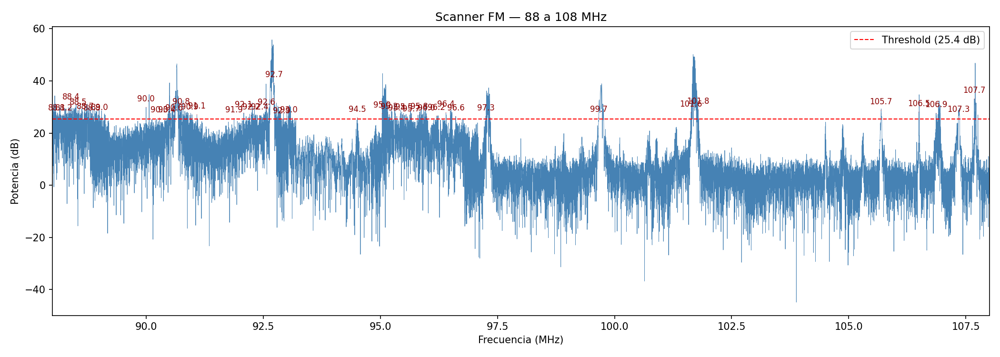
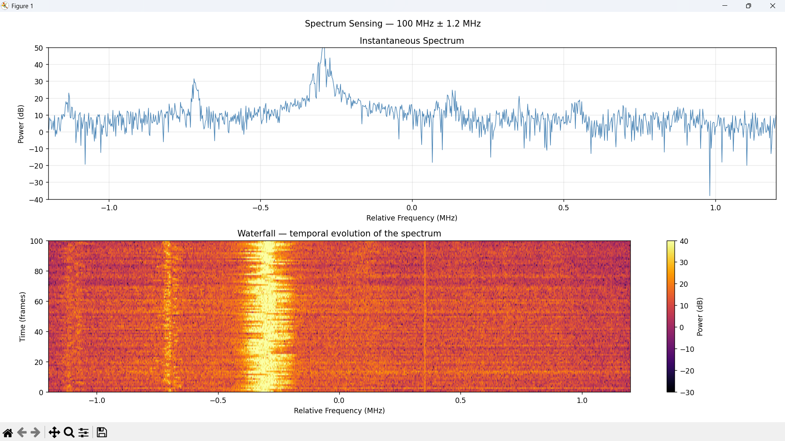
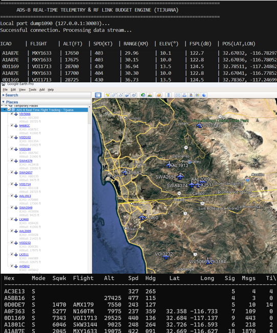
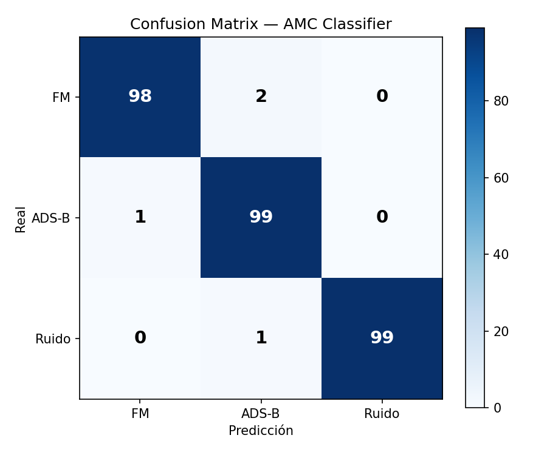
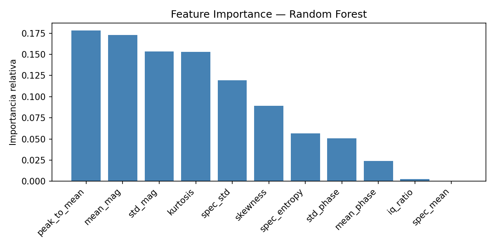

# RTL-SDR Projects

Signal processing projects using a low-cost RTL-SDR dongle and Python.
## Projects
---
### 1. FM Spectrum Scanner
Sweeps the full FM band (88–108 MHz) by capturing IQ samples at 2 MHz steps, computing the power spectral density via FFT, and automatically detecting active stations above a dynamic threshold.

---

### 2. Real-Time Spectrum Sensing + Waterfall
Continuously captures IQ samples and renders a live dual-panel display: instantaneous spectrum on top, time-frequency waterfall below.

---

### 3. ADS-B visualizer
Receives Mode S ADS-B transmissions at 1090 MHz using dump1090 for processing signals and Google Earth for live visualization using a KML file.

---

### 4. Automatic Modulation Classifier (AMC)
Trains a Random Forest classifier to distinguish FM broadcast, ADS-B, and noise from raw IQ samples.
**Feature extraction** (per 1024-sample capture):
- Time domain: mean magnitude, std, kurtosis, skewness
- Phase domain: mean and std of unwrapped phase derivative
- Frequency domain: spectral entropy, spectral std, peak-to-mean ratio
**Results:** 99% accuracy on held-out test set (300 samples, 3 classes)

---

These projects were built to develop hands-on experience with SDR and wireless signal processing.
